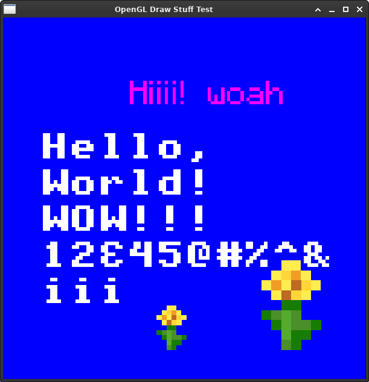

# OpenGL Draw Stuff (GlDrawStuff)
A very very simple C++ OpenGL rendering library for drawing simple shapes, textured geometry, and text.

This library provides a layer of abstraction over OpenGL for managing shaders, textures, geometry, and rendering. It's designed to make basic 2D and 3D rendering easier without completely hiding OpenGL.

## Features
- OpenGL rendering through GLAD
- GLM based transformations
- Simple shader management
- Texture loading from memory using `stb_image`
- Basic geometric shapes:
    - Triangles
    - Quadrilaterals
- Geometry batching
- Texture atlas based text rendering

## Documentation
This project includes a Doxygen configuration file, `doxygen.txt` in the repository root. With this, the API documentation can be generated using Doxygen.

## Requirements
- C++17 or later
- OpenGL 3.3 or later
- GLAD
- GLM
- `stb_image`

This library does not create an OpenGL context. An OpenGL context must already exist before creating or using the library's OpenGL objects.
